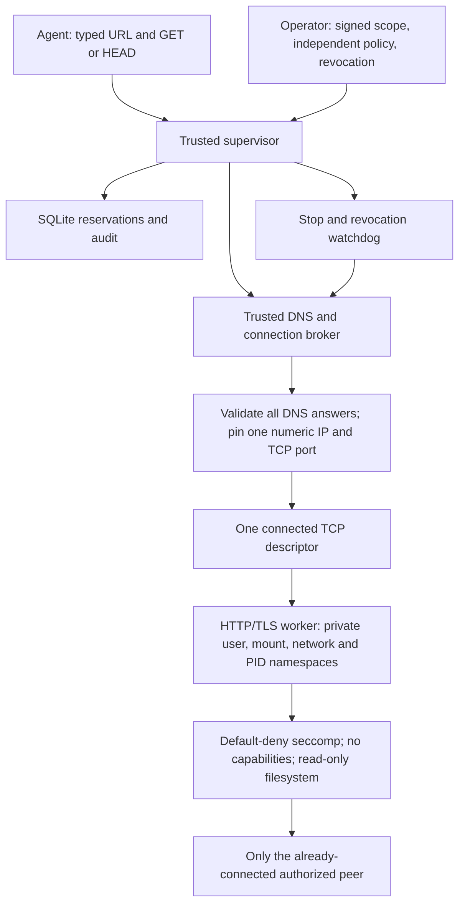

# HTTP gateway containment — v1.4.1

## Architecture

The supervisor verifies the Ed25519 signature, independent operator policy, authorization window, revocation freshness, exact origin and route grant before reserving budget. DNS resolution runs in a separately killable **trusted control-plane broker**. All returned addresses must satisfy the signed and independently verified networks and exclusions. A broad approved CIDR never becomes a worker egress grant.

The broker connects once to the selected numeric address and exact TCP port, without a second lookup. It passes only that established socket and three pipes into a fresh sandbox. The HTTP/TLS parser starts only after the launcher has verified four changed namespaces, mounted its read-only runtime and fixed code, closed other descriptors, locked securebits, dropped every capability, and loaded seccomp.

The worker has **no usable network interfaces or routes**, cannot create sockets, and cannot call `connect`, even on its granted descriptor. The established TCP connection retains its original kernel peer. Seccomp permits socket I/O only on that descriptor; a disconnected or closed connection cannot be replaced. This works for explicitly authorized IPv4, IPv6 and loopback endpoints. UDP, raw sockets, Unix-domain sockets, netlink, socket pairs, descriptor transfer, namespace changes, firewall changes, process creation, and alternate asynchronous networking mechanisms are denied.

The kernel enforces endpoint confinement even if the worker bypasses every Python authorization function. No privileged host networking broker, veth pair, host firewall mutation, dynamic nftables rule, or agent-controlled network policy is required. Compared with a network namespace plus nftables, the connected-descriptor design grants less authority and avoids rule-installation and teardown races. It deliberately supports only the fixed single-request transport.

## Process authority

### v1.5 development: credentialed HTTPS

The draft credential authority uses this same broker and sandbox for authenticated requests. The supervisor passes a protected, read-only vault descriptor to the trusted broker. The broker validates and reads a bounded bearer-token snapshot, closes the vault descriptor, loads the public TLS roots and connects the approved numeric IP/port. It supplies the token through bounded stdin to the `auth-http` worker. The helper starts only after the same namespace, capability and seccomp checks as the uncredentialed worker. The credential helper never opens a host-network socket or receives a vault path/descriptor; TLS and HTTP parsing happen inside confinement.

Credential policies, approval keys and vault entries are rejected beneath `/usr`, which is the read-only runtime visible to workers. Keep all other sensitive material out of that runtime tree as well. No workstation paths, identities or special WSL behavior are part of the implementation.

The authority checks session expiry/revocation, scope, route and CA policy while draining capped broker output. Both broker and supervisor enforce deadlines; cancellation and parent death tear down the connected capability. Authenticated output accepts only bounded status/count fields and a redirect flag. It retains no response headers, body, body hash or token. The unauthenticated transport remains unchanged in capability.

**Limit:** this helper necessarily holds the granted token in memory. A compromised helper can send it or arbitrary traffic to its one authorized endpoint and can encode information in otherwise valid metadata or timing. Endpoint confinement is not a proof of secret non-disclosure, correct HTTP semantics or instant revocation. An endpoint may already possess the credential when cancellation occurs. The draft still needs an authenticated operator-service boundary and deployment security review; see `V1_5_IMPLEMENTATION_STATUS.md`.

| Component | Authority |
|---|---|
| Operator | Signs scopes; controls policy, CA roots, revocations, service installation and audit checkpoints. Private signing keys stay outside runtime workers. |
| Supervisor | Validates scope/policy, reserves budgets, records evidence, checks stop/revocation and launches only fixed broker operations. Non-root service identity. |
| DNS/connection broker | Trusted control plane with host networking; resolves the approved hostname and opens the exact approved numeric TCP endpoint. Loads verified public CA material, creates the worker, caps output and independently enforces its deadline. Never exposed to agents. |
| Namespace launcher | Temporarily has capabilities **only within its new user namespace** for mounts; drops them before assessment code executes. |
| Assessment worker | Namespace UID 0 maps to the non-root host UID, but securebits, empty capability sets and no-new-privileges prevent root authority. Receives one connected TCP socket, pipes, read-only runtime and fixed code. No host configuration, ledger, signing keys or extra directory handles. |

Operator code, OS runtime and configuration must be installed outside agent-writable paths. No containment claim covers an attacker controlling the host, kernel, trusted broker/supervisor, operator policy or signing keys. An agent with a separate unrestricted host tool can bypass AEGIS.

## Lifetimes and failure handling

Each operation consumes the existing durable request, per-origin rate, concurrency, runtime, evidence and worst-case response-body reservations **before DNS or TCP connection**. Failures remain charged and audited.

The supervisor rechecks authorization, route grants, CA policy, revocation and emergency stop while the broker runs. Cancellation kills its process group. Independently, kernel parent-death signals connect supervisor → broker → unshare; unshare's kill-child behavior and PID namespace teardown kill the worker and close its socket after parent crashes. A broker watchdog outside the worker enforces a wall-time deadline even if the worker ignores application timeouts. Worker stdout/stderr are capped before reaching the supervisor.

Namespace mounts have no host persistence. Normal completion, errors, timeout and cancellation close sockets and destroy the private namespaces. A SIGKILL can leave an empty, mode-0700 temporary directory under `/tmp/aegis-http-*`; it contains no firewall policy, credentials, mount or reusable network grant. Operators may remove those empty directories after checking no corresponding process is live. Restart always creates a fresh boundary and reauthorizes; no network rules are recovered from repository files.

Setup failure can occur after the trusted broker has established an **authorized** TCP connection, but before any HTTP bytes are sent. No assessment code runs until confinement succeeds; there is no unconfined fallback. Tests inject failures at every mount step, capability dropping and seccomp installation, and interrupt partial setup.

## Protections retained and precise limits

- Exact origin, port, route prefixes, excluded networks, DNS rebinding checks and all-answer validation remain supervisor controls.
- The worker verifies the inherited peer against the pinned IP/port. Host headers and HTTPS SNI retain the approved hostname. TLS verifies certificates/hostnames against a broker-supplied snapshot of system roots plus any protected, fingerprint-checked operator CA.
- GET/HEAD only; no redirects, proxies, credentials, arbitrary headers or bodies. Response bodies are bounded, hashed and discarded.
- The kernel confines a **TCP endpoint**, not HTTP semantics. A compromised worker can send arbitrary bytes to its one granted endpoint until killed; it could violate GET/HEAD, route or response-body rules or forge metadata. Those remain trusted application guarantees. This milestone does not make authenticated testing or arbitrary payload execution safe.
- Response-body quotas exclude DNS, headers, TCP/TLS overhead and malicious-worker traffic. No exact kernel wire-byte quota is claimed. Fixed process count, inherited resource limits, capped pipes and the external deadline bound this worker; cgroups and arbitrary tools are outside this release.
- Plain HTTP provides no cryptographic identity. GET may change state on poorly designed servers. Use explicitly authorized staging endpoints.
- Off-host checkpoint retention, credential brokering, authenticated approval services and external notifications remain future/operator responsibilities.

## Acceptance evidence

`tests/test_egress.py` executes a fixed malicious probe through the production sandbox profile. It proves authorized TCP I/O while actual Python and raw libc socket/connect attempts return EPERM, including IPv6/UDP/Unix/netlink paths and namespace escape. It also covers descriptor hygiene, concurrent workers, missing prerequisites, interrupted setup, bounded output, deadlines and supervisor death. `tests/test_http_gateway.py` retains signed-scope, TLS, DNS, redirects, budgets, stop and revocation integration tests. `tests/test_isolation.py` retains fresh-interpreter and source-review tests.

On the v1.5 branch, `tests/test_auth_egress.py` substitutes hostile code into the actual `auth-http` profile through test-only launchers. It repeats the raw-syscall attacks after a real TLS exchange, checks vault/descriptor isolation, injects setup failures, rejects wrong peers and forged metadata, floods both output pipes, and verifies TCP closure on live revocation, expiry, stop, route/CA changes, deadlines and supervisor death. The production code has no attacker-selectable executable or test hook. `tests/test_auth_http.py` runs real confined authenticated TLS, certificate rejection and redacted evidence tests without stubbing the broker.

See `VERIFICATION.md` for environments actually tested. Run the acceptance tests on each deployment host; a passing unit test is not kernel evidence.
